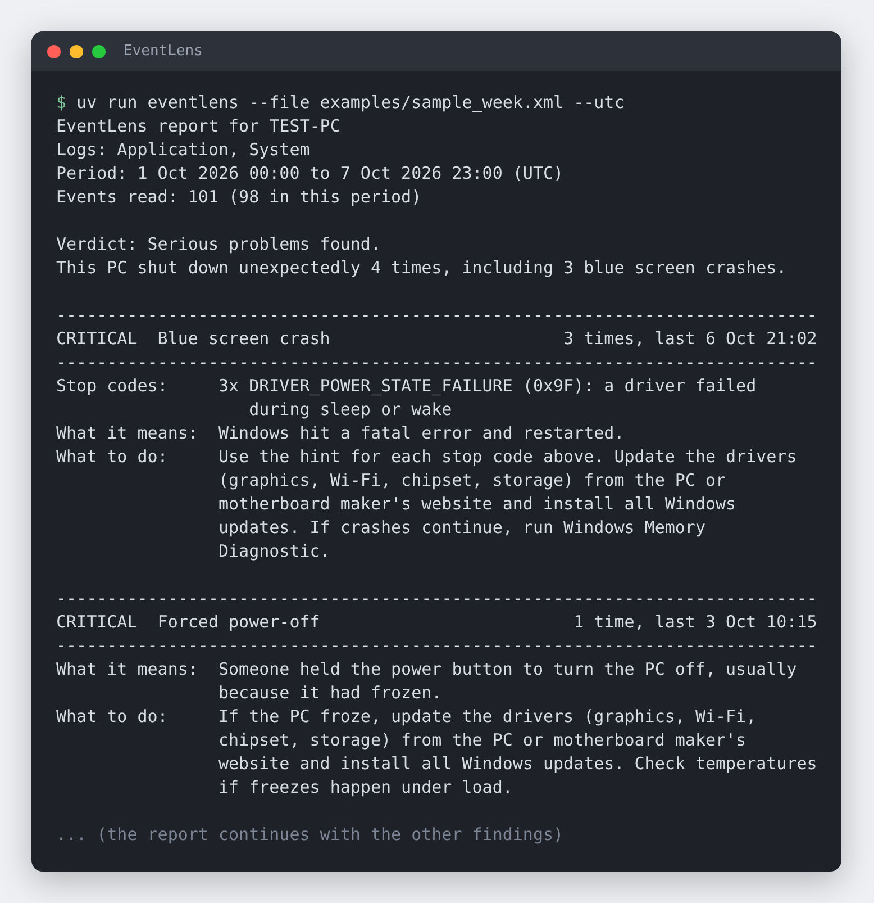

# EventLens

[](https://github.com/jimjamscott22/EventLens/actions/workflows/tests.yml)

A command-line tool that reads Windows event logs and turns them into a plain-English report of what went wrong on a machine.



*Real output from `eventlens --file examples/sample_week.xml --utc`, a made-up week on a troubled PC. The picture shows the top of the report.*

Windows records everything that goes wrong, but Event Viewer shows thousands of entries with cryptic sources and numeric IDs, and most of them are harmless. EventLens reads the System and Application logs, picks out the entries that matter, groups the repeats, ranks them by how serious they are, and says what each one means and what to do about it.

It only ever reads logs. It never changes the machine and never connects to the internet. Power diagnostics (battery and sleep reports) are planned but not built yet; see the [roadmap](#roadmap).

## Quick start

EventLens uses [uv](https://docs.astral.sh/uv/), which also installs the right Python for you.

```bash
git clone https://github.com/jimjamscott22/EventLens.git
cd EventLens
uv run eventlens --file examples/sample_week.xml
```

Or run it straight from GitHub without cloning:

```bash
uvx --from git+https://github.com/jimjamscott22/EventLens eventlens --file system.evtx
```

On a Windows PC, run it with no arguments to check that machine's live System and Application logs for the last 7 days:

```bash
uv run eventlens
```

### Getting a log from a Windows PC

You can analyse a Windows log on any computer (Windows, macOS, or Linux) by exporting it first:

- **Event Viewer:** open *Windows Logs*, right-click *System*, choose *Save All Events As...*, and save it as an `.evtx` file. Do the same for *Application* if you like.
- **Command line:** `wevtutil epl System system.evtx` (this may need an administrator prompt).

Then run `eventlens --file system.evtx --file application.evtx` wherever you like.

## What it reports

EventLens recognises 27 event types, plus 12 common blue screen stop codes, and sorts what it finds into five levels: **Critical**, **High**, **Medium**, **Low**, and **Info**.

| Area | Examples |
| --- | --- |
| Crashes | Blue screens (with the stop code named and explained), forced power-offs, sudden power loss |
| Hardware | Fatal and corrected processor, memory, and PCIe errors; drive bad blocks and retries; file system corruption |
| Apps and services | App crashes and hangs, .NET crashes, services that crash or fail to start |
| System health | Display driver resets, low memory, drives nearly full, drivers that failed to load, failed Windows updates |
| Network | Website name lookups timing out |
| Normal activity | Planned restarts and the harmless DCOM 10016 warnings are listed separately, so they don't alarm anyone |

Errors EventLens doesn't recognise yet are listed at the end by source and ID (the top 10 by default, and warnings too with `--include-warnings`). The full list of what it does recognise lives in [`catalog.py`](src/eventlens/catalog.py).

### Options

| Option | What it does |
| --- | --- |
| `--file PATH` | Read an exported `.evtx` or `.xml` log (repeat to combine several) |
| `--days N` | Look at the last N days (1 to 36500, default 7). For files, counted back from the newest event in the file. |
| `--channel NAME` | Live mode only: which log to read (default: System and Application) |
| `--include-warnings` | Also list warnings EventLens doesn't recognise yet, not just errors |
| `--utc` | Show times in UTC instead of local time |
| `--verbose` | Show the latest raw event behind each finding |

Run `eventlens --help` for all of them. Exit code 0 means a report was produced; 2 means bad arguments or an unreadable log.

## How it works

```
 .evtx / .xml file            sources.py        catalog.py         analyzer.py        report.py
 or live Windows log  ---->  read events  ---->  match each  ---->  group, combine ---> plain-text
 (wevtutil)                                      event to a rule     crashes, rank      report
```

1. **Read** (`sources.py`): `.evtx` files are parsed with the [`evtx`](https://pypi.org/project/evtx/) library, which has ready-made installs for Windows, macOS, and Linux. Event Viewer `.xml` exports are parsed directly. Live logs come from Windows' built-in `wevtutil`. Damaged records are skipped and counted instead of stopping the read.
2. **Match** (`catalog.py`): each event is looked up by its source and ID. A rule holds the plain-English title, what it means, what to do, and how to pull useful details (the app name, the service, the update) out of the event data. `.evtx` files contain no message text, so everything the report says comes from these rules.
3. **Group** (`analyzer.py`): repeats become one finding with a count and first and last times. Some rules get more serious when they repeat: ten corrected memory errors are worse than one.
4. **Combine crashes**: one crash leaves two or three events when the PC restarts. Counting each would triple-count it, so crash events from the same computer within 10 minutes become one incident: a blue screen, a forced power-off, or a power loss.
5. **Rank and render** (`report.py`): findings are ordered by severity, then count, then recency, and written as plain text that fits in 75 columns, so it pastes cleanly into an email or ticket.

The design, the decisions behind it, and the sample report are written up in [SPEC.md](SPEC.md).

## What has and hasn't been tested

**Tested**

- 167 automated tests, run on Windows, macOS, and Linux with Python 3.11 and 3.13 on every change. One test compares the whole report for the sample week against a saved copy.
- **Live mode on real Windows:** GitHub's Windows runners read the real System log through `wevtutil`, and write an event with accented and Japanese text and read it back intact.
- **A real log:** I also ran it on a real 1,881-event Windows 10 System log from 2017 (a sample from the [evtx project](https://github.com/omerbenamram/evtx); not included here). Service names, drive paths, and update titles and error codes all came through correctly.

**Not tested**

- A normal Windows 10 or 11 PC, a standard (non-administrator) user, or a non-English Windows. Live mode has only run on GitHub's Windows runners, which have administrator rights.
- Logs captured from a PC that actually crashed. The crash handling is tested with made-up events that follow the documented layouts, not with real crash logs.
- Speed on very large live logs. By default it reads the newest 5,000 events per log.

**Known limitations**

- Severity is a rule of thumb. On the real 2017 log, the Windows 10 service *Interactive Services Detection* logged a service error 10 times, which looks like routine noise rather than a fault, yet EventLens reports it as a **High** "Service stopped unexpectedly" and makes it the top issue. The catalog doesn't know which services are noisy yet.
- Events outside the catalog only show their source and ID, with no explanation.
- The catalog is small on purpose: 27 event types. It will miss problems that other events record.

## Roadmap

The plan is in [SPEC.md](SPEC.md#10-roadmap). In short:

- [x] **M0 and M1:** read `.evtx`, `.xml`, and live logs; the catalog; crash incidents; the plain-text report
- [ ] **M2:** JSON and Markdown output, colour, and exit codes that scripts can check
- [ ] **M3:** power diagnostics (battery wear, sleep and wake problems)
- [ ] **M4:** a timeline of boots and shutdowns, and what happened before each crash
- [ ] **M5:** a bigger catalog kept in a data file, with noisy services handled
- [ ] **M6:** publish to PyPI, and a standalone Windows `.exe`

## Development

```bash
uv sync            # create the virtual environment and install dependencies
uv run pytest      # run the tests
uv run ruff check  # check code style
```

The two tests that run the real `wevtutil` only run on Windows in CI, because they write an event to the log.

- After an intended change to the report, regenerate the saved copy with `EVENTLENS_UPDATE_GOLDEN=1 uv run pytest tests/test_report.py`.
- The sample week is generated by `examples/make_sample_week.py`, and the picture above by `docs/make_report_image.py`.

## Privacy

EventLens reads logs and prints a report. Nothing is sent anywhere. Reports can contain the computer name, app names, and file paths, so look over a report before you share it.

## License

[MIT](LICENSE)
